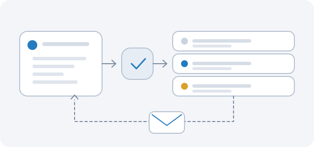

# 鲸鱼尾巴 · dsh-whale-middleman



主会话当**鲸鱼尾巴**：**盘问 → 收敛 → 人工批准 → 派发独立子会话（挂起等执行）→ 结果自动回传**。
子会话跑到一半需要人拍板时，会主动停下来等你。

## 是什么

一个 DeepSeek Harness（DSH）插件。它补的是现成方案缺的那一层：

| 现成能力 | 缺什么 |
|---|---|
| `subagent` 工具 | 立刻就跑，没有挂起；模型和父会话相同 |
| 小队（dsh-agents） | 能钉预设和模型，但一调就开跑 |
| 任务板 | 有 todo 列当挂起，但没有「派发前先把设计问清楚」 |

中台补的是这一层：**派发时把会话建好、模型定好，但不发第一条消息**——等你点执行。
所以它适合「能拆成几块并行做的事」：调研 + 实现 + 验收，你想在花钱之前先看清每块活到底要干什么。

名字的意思是：鲸鱼往前游，尾巴控制方向。它不是让 AI 游得更快——是让它在
该拐弯的地方停下来等你。

## 工具

工具是模型面向的。人在三处动手：侧边栏「中台」、对话流里的派发卡片、主会话对话本身。

| 分组 | 工具 | 做什么 |
|---|---|---|
| 设计 | `design_open` | 开一个设计批次（盘问阶段的容器）。没有批次，`dispatch_task` 一律拒绝 |
| 设计 | `design_round` | 取下一轮要问的问题。前沿 = 前置条件已满足的决定；没登记风险时一定带一个风险探测问 |
| 设计 | `design_question` | 记一条问答（问题原话 + 用户原话 + 推荐答案与理由）。派发前至少 3 条 |
| 设计 | `design_answer` | 定一个决定，或登记一条风险。风险四栏（触发 / 影响 / 缓解 / 验证）缺一栏就拒 |
| 设计 | `design_plan` | 写流程规划：分几步、每步产出什么、什么能并行、卡点在哪 |
| 设计 | `design_converge` | 收敛成规格（目标 / 不做什么 / 验收标准），会校验前沿清空、风险齐全、依赖边合法 |
| 设计 | `design_split` | 把规格拆成工单。每张必须挂风险（或写 `riskFree` 加理由）、写 `modelReason`、定模型；阻塞边不能成环 |
| 派发 | `dispatch_task` | 建子会话、定模型、挂起，**不发第一条消息**。必须带 `batchId` |
| 审阅 | `middleman_status` | 读批次状态、工单、每张票的子会话；传 `ticketId` 时连回传正文一起返回 |
| 审阅 | `middleman_inbox` | 列出所有停下来等人的票（`waiting`）：问题、选项、建议 |
| 恢复 | `middleman_rewire` | 改一张未结束票的依赖表（前序失败时把下级摘出来），改完立刻重算依赖 |
| 恢复 | `middleman_rebind` | 把票重绑到另开的新会话；之后新会话的 turn/end 结算到这张票 |
| 子会话 | `request_confirmation` | 子会话需要人拍板时调它：票变 `waiting`，并立刻推一条消息到主会话 |

派发前的硬闸门写在代码里，不写在提示词里：至少 3 个已回答的问题、一份流程规划、
至少一条四栏齐全的风险，缺一不可；`modelReason` 与 `model` 缺一不可。

## 批准只发生在会话里

`approve` 不在工具面上——**模型没有对应的工具可调**，批准只能由人在中台面板上点。
这是刻意设计：让模型自己批自己，等于没有闸门。

批准发生在两个时刻：

1. **设计批准**：收敛后，你在侧边栏「中台」的批次详情里点「批准这份设计」。批准前
   `design_split` 只产出草稿票，可以反复改；批准后票锁定，改票会被拒。
2. **执行批准**：`dispatch_task` 建好子会话、钉好模型后是挂起状态；你在对话流里的
   派发卡片上点「执行」，子会话才收到第一条消息。**没点执行不花钱。**

另有一条「等人」通道：子会话跑到一半不确定时调 `request_confirmation`，票从
`running` 变成 `waiting`，并立刻回推一条消息到主会话。这不是失败，是「等你」。

## 回传信封协议

子会话结束（或出错）时，插件推回主会话的只有一封**信封**，不塞正文：

```
{ batchId, ticketId, turn, status }
```

正文一律用 `middleman_status` 取——envelope 说「去哪取」，账本才是内容。
这样回传不会把整段子会话上下文灌进主会话。

状态机（票级）：

```
draft ──批准──▶ queued ──前序完成──▶ suspended ──人点执行──▶ running
                                          │                     │
                                          └── pending（未派发） ─┘
running ──▶ done / partial / failed
        └─▶ waiting（子会话主动停下来等人）
cancelled（人按的停止）    interrupted（传输中断，可续跑一次）
```

- `suspended` 是「会话建好了、你还没点执行」；`waiting` 是「跑到一半停下来问你」。
  两者都不是失败。
- `partial` 表示产出不完整：撞 `max-tokens`、宿主重启把进程收走，都记 `partial`，
  正文标出原因，不当作任务失败——长任务被截断很常见，一律标失败你会开始忽略失败通知。
- 传输层断开（`error.code === 'TRANSPORT'`）记 `interrupted`，会**自动续跑一次**；
  人按的停止记 `cancelled`，**不会**续跑。
- `waiting` 是「等你」，不是 `failed`。别把两者混起来。
- `middleman_rewire` / `middleman_rebind` 只改台账，不向任何子会话发消息；改完是否
  启动仍由整批依赖重算决定。

## 安装

要求：DSH `>= 0.2.1-rc.3`、Node `>= 22`。

### 方式一：应用内安装（推荐）

1. 拿到包目录（`git clone` 仓库，或解开 `dsh-whale-middleman-0.2.0.tgz` 得到 `package/`，
   目录根下有 `cordis.patch.yml`）。
2. 打开 DeepSeek Harness → 侧边栏「插件」→「安装」→ 选本地目录 / 粘贴本地路径。
3. 列表出现 `dsh-whale-middleman` 后启用。
4. **完全退出 DSH 再打开**（不是关窗口）。

### 方式二：插件管理器 API

```js
plugin_manager({ action: "install_bundle", target: "<包目录的绝对路径>" })
```

### 装完怎么验

重启后侧边栏多一行「中台」；主会话的系统提示里出现中台段；对模型说「开个设计批次」，
它应该回你 2～4 个带推荐答案的问题（其中一个是风险探测）。

### 卸载

在「插件」里禁用或移除 `dsh-whale-middleman`，然后完全退出应用再打开。
台账不会自动删，见下一节。

## 数据在哪

| 什么 | 哪儿 |
|---|---|
| 台账（一个批次一份，只存状态与引用） | `~/.dsh/whale-tail/designs/<batchId>.json` |
| 会话正文 | 各自会话里，台账不存 |
| 回传正文 | 用 `middleman_status` 读，别自己翻 JSON 文件 |

台账根目录按这个顺序找：`WT_HOME` 环境变量 → `~/.dsh/whale-tail`（正常位置）→
`~/.dsh/middleman`（改名之前的旧位置，只在新目录还没建时沿用）。**不会自动搬家**：
旧目录里有批次就继续用旧的，想迁就手动挪。

## 边界与限制

- 只写本地：`git push`、`npm publish` 都不由插件做，也没有对应工具。
- 模型必须支持工具调用；没有工具调用的模型只能当普通对话用。
- 它不替你回答盘问，也不替你批准——这两件事是设计上留给人的。
- 关掉插件后：已建会话照跑，但批次不再结算、回传不会推回来；重新启用后账本还在。
